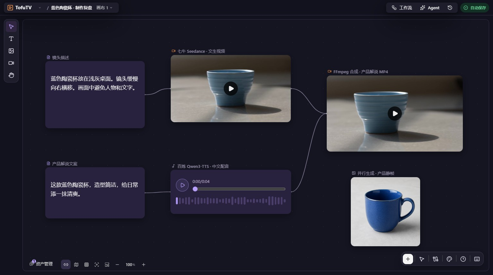
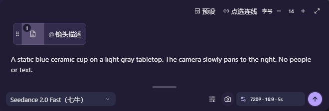
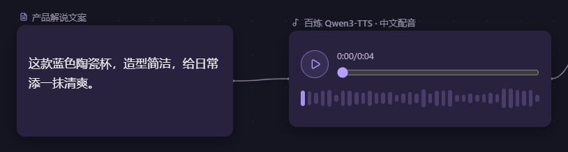

# TofuTV

[简体中文](README.md) · [Case study](#case-study) · [Quick start](#quick-start) · [Documentation](docs/index.md)


**Go from an idea to a finished video, with every shot on an editable canvas.**

TofuTV is a workspace for AI short films, product videos, and storyboard previews. Break a script into shots, attach visual references, and generate clips on the same canvas. Assemble the clips with narration and subtitles on the timeline. When a shot needs changes, return to its node and pick up with the prompt and references already in place.

## One canvas for video creation

| What you want to do | How TofuTV helps |
| --- | --- |
| **Build a storyboard** | Organize shots with text, image, video, and audio nodes. Connect dialogue, character images, and other assets to downstream nodes. |
| **Direct a shot** | On supported models, use general references to guide appearance and style, or assign first and last frames to shape the opening and ending. |
| **Edit and add sound** | Arrange shots on the timeline, add narration, music, and subtitles, then preview and export the video. |
| **Reuse your work** | Find results in **Assets → Generation History** and save useful node combinations as workflows for the next project. |
| **Work with an assistant** | Ask TofuTV Agent to draft a storyboard or organize assets. Connect TofuTV MCP to use workspace tools from an external assistant. |

Add your own providers in **Model Configuration** and choose defaults for text, images, video, and audio. Available reference modes, settings, and billing depend on the model and provider. [Feature guide](docs/content/docs/overview/features.mdx)

## Case study

**Blue ceramic cup product demo.** A five-second product shot at 720p in 16:9. The camera pans right. The shot and the narration were generated separately and combined into one MP4.



*This recap canvas was assembled from the actual task records and media. GPT Image 2 produced the standalone product still in the lower right.*

**Generate the shot.** Use Seedance 2.0 Fast through Qiniu for text-to-video. The prompt describes a blue ceramic cup on a light gray tabletop and a slow pan to the right.



**Generate the narration.** Alibaba Cloud Model Studio’s Qwen3-TTS Flash read a short Mandarin line introducing the cup and returned a WAV file.



**Export the clip.** FFmpeg kept the original video stream and encoded the narration as AAC in the MP4.

## Quick start

### Start TofuTV

To run from source on Windows, install Go 1.26, Bun, and a GCC toolchain for CGO. Run these commands in PowerShell.

```powershell
git clone https://gitee.com/hongxingyou/tofu-tv.git
cd tofu-tv
.\scripts\start-local.ps1
```

Open the [local TofuTV workspace](http://localhost:3000) after startup. To stop it, press `Ctrl+C` in both development windows.

For an existing Windows workspace with the local Docker backend, Node.js, and web dependencies configured, use `启动TofuTV.bat` to start it and `关闭TofuTV.bat` to stop it.

### Generate your first clip

1. Add a provider in **Model Configuration** and choose the default video model.
2. Create a project, click **+** on the canvas, and add a **Video** node.
3. Describe the scene, movement, and camera. For image references, connect the pictures to the video node and select a mode your model supports.
4. Set the aspect ratio and duration, then click **Generate**. Preview the clip on the canvas or download it from **Assets → Generation History**.

Try this prompt to get started.

> Warm orange streetlights reflect in a rain-soaked city street. A yellow tram crosses from right to left as the camera slowly moves forward.

You can also open the first-creation guide at the bottom of the home sidebar and follow its highlighted controls.

## Deployment and data

- **Local Docker deployment.** In an environment with Bash and Docker Compose, run `./scripts/beeftv-docker.sh build` and then `./scripts/beeftv-docker.sh start`. [Local development and Docker configuration](docs/content/docs/backend/local-development.mdx#docker-开发)
- **Desktop builds.** Build the desktop app from source with the dependencies for your platform. [Desktop quick start](QUICKSTART.md)
- **Data and credentials.** Local mode stores projects, assets, and model settings in the workspace. When you use an external model, its request and relevant references go to the provider you configured. Keep API keys and workspace data on your machine. [Security guidance](SECURITY.md)

## Documentation

- [Creation and workflow examples](docs/content/docs/overview/examples.mdx)
- [Model and protocol plugin integration](docs/content/docs/plugins/plugin-generation.mdx)
- [Connect Codex and other external assistants](docs/content/docs/backend/external-agents.mdx)
- [Browse the Gitee repository](https://gitee.com/hongxingyou/tofu-tv)

## Upstream project and license

TofuTV is based on [glanderness/BeefTV](https://github.com/glanderness/BeefTV). This version updates the workspace branding and icon, canvas controls, first-creation guide, and Windows launch scripts. The upstream repository contains the original project's releases and installers.

Eligible BeefTV-authored material is governed by the [BeefTV Source Available License 1.0](LICENSE). Earlier MIT material and third-party components retain their respective licenses. See sections 4 and 5 of `LICENSE` for distribution and hosting terms. [Attribution](NOTICE) · [Third-party notices](THIRD_PARTY_NOTICES.md)
