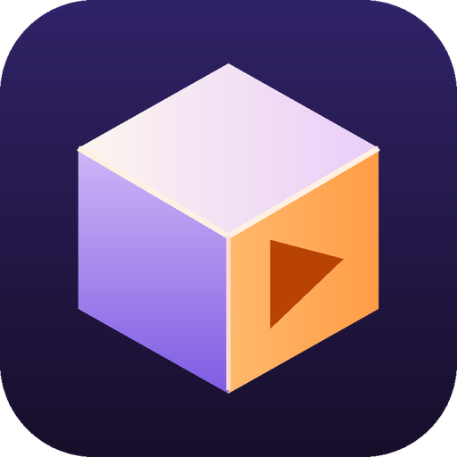

# DofuTV



An AI video creation workspace. Write scripts, build storyboards, and generate shots on one canvas.

[简体中文](README.md) · [Documentation](docs/index.md) · [Gitee repository](https://gitee.com/hongxingyou/beeftv)

## Creative workspace

- Organize scripts, storyboards, and assets on a canvas and connect image, video, text, and audio models.
- Manage content in projects and the asset library. Save repeatable steps as workflows.
- Add your own providers in Model Configuration, such as local Ollama or Alibaba Cloud Model Studio. The upstream compute channel is a separate service with its own accounts and billing.

## Run locally

On Windows, run the following command from the repository root. The script requires Go and Bun.

```powershell
.\scripts\start-local.ps1
```

Open [http://localhost:3000](http://localhost:3000) after startup. See [local development](docs/content/docs/backend/local-development.mdx) and the [Docker Compose configuration](docker-compose.dev.yml) for other ways to run the app.

The local workspace stores model keys and project data. See the [security guidance](SECURITY.md) for access and credential management.

## Upstream project and license

DofuTV is a derivative of [glanderness/BeefTV](https://github.com/glanderness/BeefTV). This version changes the workspace branding, app icon, desktop window title, and repository links. BeefTV names, installers, and release notes in the upstream documentation refer to the original project.

The [BeefTV Source Available License 1.0](LICENSE) governs eligible upstream additions. Prior MIT material and third-party components retain their licenses. See section 5 for commercial distribution and services offered to third parties, and [NOTICE](NOTICE) and the [third-party notices](THIRD_PARTY_NOTICES.md) for attribution.
