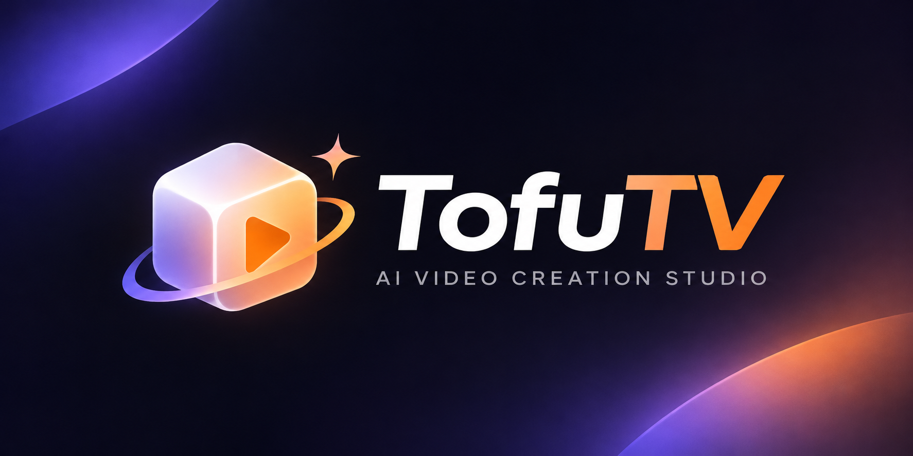

# TofuTV

[English](README.en.md) · [快速开始](#快速开始) · [项目文档](docs/index.md)



**从一句创意到一条成片，把每个镜头留在可编辑的画布上。**

TofuTV 面向 AI 短剧、产品视频和分镜预演。你可以在同一张画布上拆剧本、用参考图确定人物外观、生成镜头，再把视频、配音和字幕交给时间线。要改一个镜头时，可以回到对应节点，继续使用它的提示词和参考素材。

## 一张画布，贯穿视频创作

| 创作任务 | 你可以怎么做 |
| --- | --- |
| **搭分镜** | 用文本、图片、视频和音频节点组织镜头，通过连线把台词、角色图和素材交给下游节点。 |
| **控制生成镜头** | 在支持的模型上用「全能参考」引导人物或风格，或用「首尾帧」指定开场和结尾画面。 |
| **剪辑与配音** | 在时间线排列镜头，添加旁白、背景音乐和字幕，再预览与导出成片。 |
| **复用素材与流程** | 从「资产 → 生成历史」找回成片，把常用节点组合保存为工作流，再用于下一次创作。 |
| **调用创作助手** | 让 TofuTV Agent 起草分镜或整理素材。也可以通过 TofuTV MCP 把工作区工具接入外部助手。 |

在「模型配置」添加自己的服务渠道，分别为文本、图片、视频和音频选择默认模型。模型和渠道决定可用的参考模式、生成参数及计费方式。 [功能清单](docs/content/docs/overview/features.mdx)

## 快速开始

### 启动 TofuTV

在 Windows 上，从源码启动需要 Go 1.26、Bun 和可用于 CGO 的 GCC 编译工具链。用 PowerShell 执行以下命令。

```powershell
git clone https://gitee.com/hongxingyou/tofu-tv.git
cd tofu-tv
.\scripts\start-local.ps1
```

启动后访问 [TofuTV 本地工作台](http://localhost:3000)。需要关闭时，在前后端两个开发窗口分别按 `Ctrl+C`。

如果你的 Windows 工作区已有本机 Docker 后端、Node.js 和 Web 依赖，可以双击根目录里的「启动TofuTV.bat」与「关闭TofuTV.bat」操作同一套工作区。

### 生成第一段视频

1. 打开「模型配置」，添加模型服务并选择「默认视频模型」。
2. 新建项目，在画布里点击「＋」，添加「视频」节点。
3. 写下画面、动作和运镜。需要参考图时，把图片连到视频节点，再选择模型支持的参考模式。
4. 确认比例和时长后，点击「生成」。在画布预览结果，或去「资产 → 生成历史」下载。

可用下面这段提示词开始。

> 雨后的城市街道，地面映着暖橙色路灯。一辆黄色有轨电车从右向左驶过，镜头缓慢向前推进。

也可以从首页左下角打开「新手引导」，跟着高亮走完第一遍。

## 部署与数据

- **Docker 本地部署**。在有 Bash 和 Docker Compose 的环境中，可用 `./scripts/beeftv-docker.sh build` 构建，再用 `./scripts/beeftv-docker.sh start` 启动。 [本地开发和 Docker 配置](docs/content/docs/backend/local-development.mdx#docker-开发)
- **桌面版**。按平台准备编译与打包依赖，从源码构建桌面应用。 [桌面版快速开始](QUICKSTART.md)
- **数据与密钥**。本地模式将项目、素材和模型配置保存到工作区。调用外部模型时，请求与相关参考素材按所选渠道的配置发送。API Key 和工作区数据目录应保存在本机。 [安全说明](SECURITY.md)

## 文档

- [创作与工作流复用案例](docs/content/docs/overview/examples.mdx)
- [接入模型与协议插件](docs/content/docs/plugins/plugin-generation.mdx)
- [连接 Codex 等外部助手](docs/content/docs/backend/external-agents.mdx)
- [查看 Gitee 仓库](https://gitee.com/hongxingyou/tofu-tv)

## 上游与许可

TofuTV 基于 [glanderness/BeefTV](https://github.com/glanderness/BeefTV) 修改。本版本更新了工作台品牌与图标、画布操作入口、新手引导和 Windows 启停脚本。上游项目的发行记录和安装包见原仓库。

BeefTV 的相应原创内容遵循 [BeefTV Source Available License 1.0](LICENSE)，历史 MIT 内容和第三方组件适用各自的许可。分发与托管条款见 `LICENSE` 第 4、5 节。 [版权与来源](NOTICE) · [第三方声明](THIRD_PARTY_NOTICES.md)
